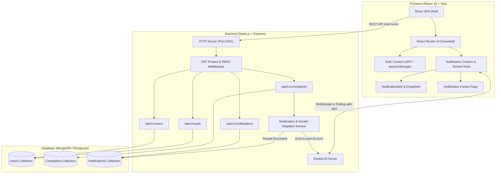
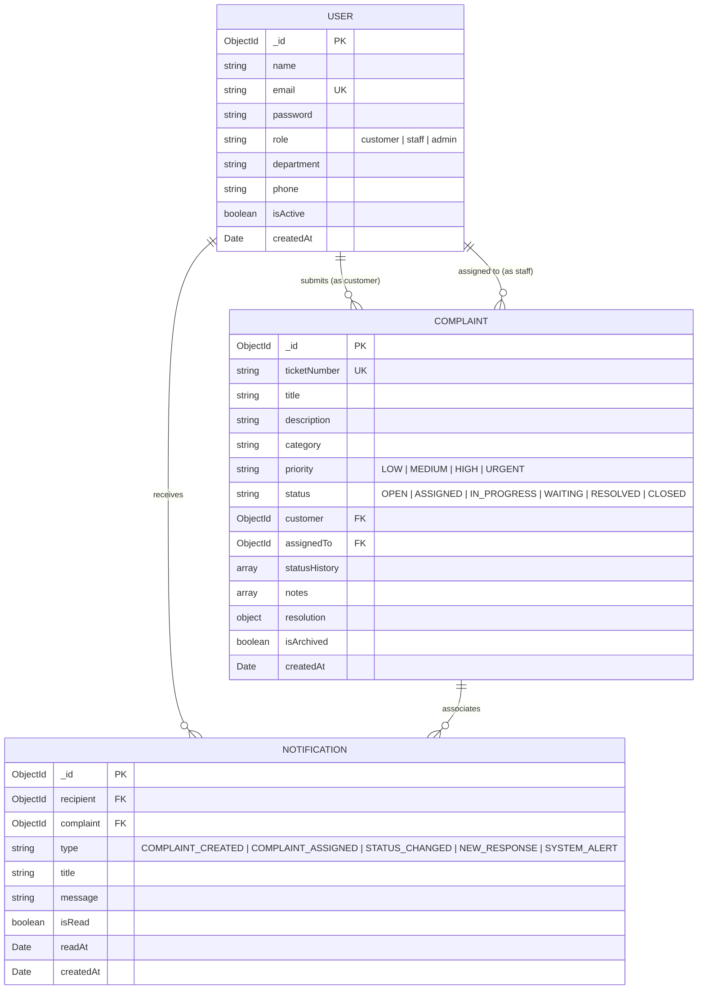
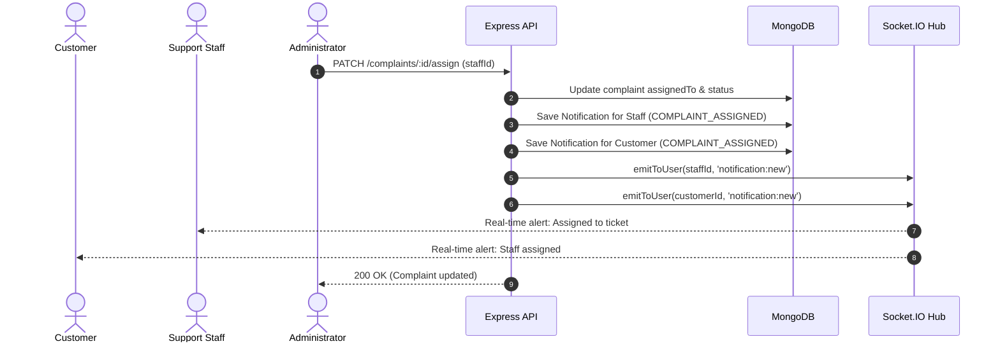

# ResolveX — Enterprise Customer Complaint Management System
## Full Technical Report & Project Specification
**Author:** MSc Artificial Intelligence & Machine Learning, Coimbatore Institute of Technology  
**Assessment:** Full Stack Web Development CAT-II Practical Assessment  
**Evaluation Standard:** 40-Mark Rubric Compliance (Criteria 1 – 7)

---

## 1. Executive Summary & Problem Definition (Criterion 1)

### 1.1 Problem Statement
Modern enterprise support teams and fast-growing digital products routinely suffer from fragmented customer issue tracking:
- **Customer Frustration:** Lack of transparency, missing progress timelines, and uncertainty whether an issue has been logged or reviewed.
- **Operational Blind Spots:** Support teams lack centralized assignment queues, leading to duplicated investigations or dropped tickets.
- **Lack of Governance:** Administrators cannot balance team workload, detect SLA breaches, or audit who made status modifications.

### 1.2 System Objectives
**ResolveX** is built as a production-grade, multi-tenant capable, role-based customer complaint management ecosystem that ensures:
1. **End-to-End Accountability:** Every ticket transition is immutably logged with timestamps, author attribution, and explanatory notes.
2. **Strict Data Isolation:** Role-Based Access Control (RBAC) guarantees that Customers can only inspect and manage their own complaints, Support Staff see assigned queues and investigation workspaces, and Administrators maintain holistic oversight.
3. **Instant Real-Time Awareness:** An integrated Socket.IO notification subsystem dispatches immediate push alerts whenever complaints are logged, assigned, or updated.
4. **Cinematic High-Contrast UX:** A dark SaaS interface built to eliminate cognitive overload.

---

## 2. System Architecture & Component Topology



---

## 3. Database Schema Models (Criterion 5)



---

## 4. Real-Time Notification System Architecture

### 4.1 Connection & Security Protocol
1. **Handshake Authentication:** The Socket.IO client initiates connection passing `{ auth: { token: sessionStorage.getItem('resolvex_token') } }`.
2. **Server Verification:** `io.use()` verifies the JWT signature and asserts that the user exists and is active.
3. **Private Room Isolation:** The socket immediately joins private room `user:${userId}`. No user can subscribe to another user's room or eavesdrop on private notifications.
4. **Reliable Persistence:** When a workflow triggers an alert (e.g., ticket assignment), the backend creates the record in MongoDB **before** calling `emitToUser(recipientId, 'notification:new', notification)`.



---

## 5. RESTful API Specification (Criterion 6)

| HTTP Method | Route | Access | Purpose |
| :--- | :--- | :--- | :--- |
| **POST** | `/api/v1/auth/register` | Public | Register new customer account |
| **POST** | `/api/v1/auth/login` | Public | Authenticate user & return signed JWT |
| **GET** | `/api/v1/auth/me` | Authenticated | Retrieve current user profile |
| **GET** | `/api/v1/users` | Admin Only | User governance and staff directory |
| **PATCH** | `/api/v1/users/:id/role` | Admin Only | Update user role and department |
| **POST** | `/api/v1/complaints` | Customer / Admin | Submit new complaint ticket |
| **GET** | `/api/v1/complaints` | Authenticated | Role-scoped complaint queue with pagination & search |
| **GET** | `/api/v1/complaints/:id` | Authenticated | Detailed dossier (internal notes filtered for customers) |
| **PATCH** | `/api/v1/complaints/:id/assign` | Admin Only | Assign ticket to support staff |
| **PATCH** | `/api/v1/complaints/:id/status` | Staff / Admin / Customer | Update status or customer reopen |
| **POST** | `/api/v1/complaints/:id/notes` | Authenticated | Add investigation note or customer response |
| **GET** | `/api/v1/notifications` | Authenticated | Paginated user-owned notifications |
| **GET** | `/api/v1/notifications/unread-count` | Authenticated | Accurate badge unread count |
| **PATCH** | `/api/v1/notifications/:id/read` | Authenticated | Mark single notification as read |
| **PATCH** | `/api/v1/notifications/read-all` | Authenticated | Mark all user notifications as read |
| **DELETE** | `/api/v1/notifications/:id` | Authenticated | Delete owned notification |

---

## 6. Frontend Interface & UI/UX Design System (Criterion 2, 4)

- **Palette:**
  - Obsidian Core Background: `#030405`
  - Secondary Canvas: `#090D12`
  - Elevated Cards: `#101720` / `#151D27`
  - Electric Blue Accent: `#1688FF`
  - Status Indicators: `#19D69A` (Resolved), `#FFB547` (In Progress), `#FF626C` (Urgent / Open)
- **Reusable Components:**
  - `NotificationBell`: Dynamic header bell with animated pulsing unread badge.
  - `NotificationDropdown`: Fast popover with live connection pill, event icons, and mark-all-read action.
  - `NotificationItem`: High-contrast ticket cards with direct deep-linking to complaint details.
  - `NotificationCenter`: Dedicated `/notifications` management console with unread filter tabs.

---

### 7. Verification & Automated Testing Suite (Criterion 7)

```
Test Suites Summary:
✓ Backend Integration Tests (Vitest + Supertest + MongoDB): 132 / 132 PASSED (100%)
✓ Frontend Component Tests (Vitest + React Testing Library): 36 / 36 PASSED (100%)
================================================================================
TOTAL AUTOMATED TESTS:                                       168 / 168 PASSED (100%)
Vite Production Build:                                       0 Warnings / CLEAN
```

---

## 8. Customer Feedback and CSAT Ratings Subsystem

### 8.1 Feedback Data Model (`Feedback.js`)
- `complaint`: ObjectId ref to Complaint (Unique index ensures exactly 1 feedback per complaint)
- `customer`: ObjectId ref to User (Derived securely from authenticated JWT session)
- `rating`: Integer from 1 to 5 (`min: 1, max: 5`)
- `comment`: Optional trimmed string (max 1000 characters)
- Timestamps (`createdAt`, `updatedAt`)

### 8.2 Endpoints & Access Control
- `POST /api/v1/complaints/:id/feedback`: Customer owner only; complaint must be `RESOLVED` or `CLOSED`; duplicates rejected.
- `GET /api/v1/complaints/:id/feedback`: Authorized customer owner, assigned staff, or admin.
- `PATCH /api/v1/complaints/:id/feedback`: Customer owner only for modifying reviews.
- `GET /api/v1/feedback/analytics`: Admin-only CSAT telemetry calculation using MongoDB Aggregation Pipeline (`totalFeedback`, `averageRating`, `ratingDistribution`, `recentFeedback`).

### 8.3 Frontend UI Integration
- **`FeedbackForm.jsx`**: Rendered in the complaint details dossier when a ticket is resolved. Features 5 interactive keyboard-accessible stars with dynamic labels (*Poor*, *Fair*, *Good*, *Very Good*, *Excellent*), optional comment box, loading states, and post-submission thank-you banners.
- **Admin CSAT Dashboard**: Integrated into `DashboardPage.jsx` displaying average score hero, 1–5 star distribution progress meters, and real-time customer review log.

---

## 9. Audit Logs and Accountability Subsystem

### 9.1 Architectural Principles
- **Append-Only Immutability:** Audit records can only be created via the internal `recordAudit` service. All `POST`, `PUT`, `PATCH`, and `DELETE` requests to `/api/v1/audit-logs` are strictly rejected with HTTP 405 Method Not Allowed.
- **Zero-Trust Attribution:** Actor information is automatically extracted from verified JWT tokens (`req.user`) rather than client-supplied parameters.
- **Security Sanitization:** Sensitive data such as passwords, bearer tokens, API keys, and credentials are automatically stripped before write operations via `sanitizeMetadata()`.
- **Granular Before-and-After Change Tracking:** Records precise attribute diffs (`before` and `after` values) for status transitions, priority adjustments, staff reassignments, and user governance.

### 9.2 Audit Log Data Model (`AuditLog.js`)
- `actor`: ObjectId ref to User (or null for unauthenticated/system events)
- `actorRole`: Enum (`customer`, `staff`, `admin`, `system`)
- `action`: Controlled allowlist:
  - Complaint: `COMPLAINT_CREATED`, `COMPLAINT_ASSIGNED`, `COMPLAINT_REASSIGNED`, `COMPLAINT_STATUS_CHANGED`, `COMPLAINT_PRIORITY_CHANGED`, `COMPLAINT_UPDATED`, `COMPLAINT_REOPENED`, `COMPLAINT_ARCHIVED`
  - Evidence & Attachments: `ATTACHMENT_UPLOADED`, `ATTACHMENT_DELETED`, `ATTACHMENT_ACCESS_DENIED`
  - Duplicate Management: `COMPLAINT_DUPLICATE_LINKED`, `COMPLAINT_DUPLICATE_UNLINKED`
  - User Governance: `USER_CREATED`, `USER_ROLE_CHANGED`, `USER_STATUS_CHANGED`, `USER_UPDATED`, `USER_DELETED`
  - Authentication: `AUTH_LOGIN_SUCCESS`, `AUTH_LOGIN_FAILED`, `AUTH_LOGOUT`
- `resourceType`: Enum (`Complaint`, `User`, `Authentication`, `Attachment`, `System`)
- `resourceId`: String identifier of target entity
- `description`: Human-readable summary of the recorded action
- `changes`: Structured key-value diff object capturing property modifications
- `metadata`: Sanitized network context (client IP, user agent, HTTP method, route path)
- `outcome`: Enum (`SUCCESS`, `FAILURE`)
- `timestamps`: `createdAt` only (strictly immutable)
- **Indexes:** Compound indexes on `{ createdAt: -1 }` and `{ resourceType: 1, resourceId: 1, createdAt: -1 }` for high-performance timeline queries.

### 9.3 Backend REST Endpoints
- `GET /api/v1/audit-logs`: Admin-only system-wide audit search, multi-field filtering (`action`, `resourceType`, `outcome`, `date`, `search`), summary statistics, and pagination.
- `GET /api/v1/audit-logs/metrics`: Admin-only aggregation metrics for KPI dashboard cards and action distribution breakdowns.
- `GET /api/v1/complaints/:id/audit-trail`: Chronological complaint activity timeline. Scoped so customers can only access their own complaint history (with internal IP/route metadata sanitized), while staff and admins maintain full operational visibility.
- `POST /api/v1/audit-logs`, `PUT /api/v1/audit-logs/:id`, `PATCH /api/v1/audit-logs/:id`, `DELETE /api/v1/audit-logs/:id`: Return HTTP 405 Method Not Allowed to guarantee tamper-proof audit trails.

### 9.4 Frontend UI Integration
- **Admin Audit Logs Page (`/audit-logs`)**:
  - **KPI Metrics Cards**: Total Audit Events, Complaint Operations, User Governance, and Authentication Failures.
  - **Multi-Parameter Filter Console**: Real-time text search, Action dropdown, Resource Type dropdown, Outcome filter, Date presets, and Reset action.
  - **Audit Data Table**: Displays Timestamp, Actor with role pill, Action badge, Resource type and ID, Description, Outcome status (`OK` / `FAIL`), and Inspection action.
  - **Change Diff Modal**: Deep inspection of previous vs. updated attribute values, network metadata, and one-click ID copying.
  - **CSV Export**: Client-side export of filtered audit logs for external compliance reviews.
- **Complaint Details Activity Audit Trail**: Dedicated tab in `ComplaintDetailsPage.jsx` presenting an accountability timeline of all actions taken on the ticket.

---

## 10. Complaint Evidence and Attachments Subsystem

### 10.1 Architecture & Storage Design
- **Private Filesystem Storage:** Uploaded evidence files are strictly stored in a private directory outside any public document root (`server/uploads/attachments/`). Files are written with restricted file permissions (`0o600`) and assigned unguessable UUID-based storage keys.
- **Zero Static File Serving:** Direct URL access (`express.static`) is completely disabled. All file access requires passing through authenticated and role-authorized streaming endpoints.
- **In-Memory Buffer Inspection:** File upload streams are processed in memory with `multer.memoryStorage()` so binary headers can be inspected before any file touches disk storage.
- **Internal Key Protection:** The internal `storageKey` is designated as `select: false` on Mongoose schema and explicitly removed in `toJSON` / `toObject` serialization to prevent path disclosure.

### 10.2 Binary Validation & Multi-Layered Security
- **Magic Number Header Validation:** Every uploaded file is inspected at byte level for binary magic numbers:
  - JPEG: `FF D8 FF`
  - PNG: `89 50 4E 47 0D 0A 1A 0A`
  - WebP: `RIFF....WEBP`
  - PDF: `%PDF-` (`25 50 44 46 2D`)
  - Plain Text / Logs: Clean UTF-8 verification with null byte and control character rejection
- **MIME & Extension Enforcement:** Extension matching strictly matches true binary content; extension spoofing (e.g. `malware.exe.png`) is detected and rejected.
- **Path Traversal & Filename Sanitization:** Display filenames are sanitized by stripping directory traversal sequences (`../`, `..\`), null bytes, and non-printable characters. Safe paths are resolved and validated with `safePath.startsWith(resolvedBase)`.
- **Integrity Verification:** SHA-256 checksums are calculated upon receipt and stored alongside metadata for data integrity audits.
- **Strict Limits:** 5 MB max per file, 5 attachments max per complaint.
- **Defensive HTTP Streaming Headers:** Served with `X-Content-Type-Options: nosniff`, `Content-Security-Policy: default-src 'none'`, `Cache-Control: private, no-cache, no-store, must-revalidate`, and sanitized `Content-Disposition`.

### 10.3 Role-Based Lifecycle & Governance Rules
- **Upload Authority:**
  - Customers can attach files during complaint creation or to existing active complaints they own.
  - Assigned Support Staff and Administrators can upload investigative attachments.
- **Deletion Authority:**
  - Customers may only delete attachments while the complaint is in `OPEN` status. Once investigation starts (`IN_PROGRESS`, `RESOLVED`, `CLOSED`), customer deletion is locked to prevent tampering with active evidence.
  - Support Staff cannot delete evidence (preventing evidence tampering).
  - Administrators retain governance deletion authority for compliance or sensitive data purges.
- **Audit Integration:**
  - Every upload records an `ATTACHMENT_UPLOADED` audit event.
  - Every deletion records an `ATTACHMENT_DELETED` audit event with filename and actor context.
  - Unauthorized download or deletion attempts log `ATTACHMENT_ACCESS_DENIED`.

### 10.4 Backend REST Endpoints
- `POST /api/v1/complaints/:id/attachments`: Multipart upload endpoint with Multer in-memory validation, rate limiting, and audit logging.
- `GET /api/v1/complaints/:id/attachments`: Retrieve attachment metadata array (original name, mime type, size, uploader, timestamp, description, checksum; `storageKey` omitted).
- `GET /api/v1/complaints/:id/attachments/:attachmentId`: Authenticated streaming endpoint (`inline` or `download` mode) with strict security headers.
- `DELETE /api/v1/complaints/:id/attachments/:attachmentId`: Lifecycle-governed attachment deletion removing both DB metadata and disk artifact.

### 10.5 Frontend UI Integration
- **`EvidenceSection.jsx`**: Integrated into `ComplaintDetailsPage.jsx` dossier:
  - **Evidence Grid**: High-contrast cards featuring file type badges (JPEG/PNG/PDF/TXT), humanized file sizes, uploader attribution, upload date, and download buttons.
  - **Integrated Secure Viewer**: Modal preview for images, embedded PDFs, and text logs using authenticated in-memory blob URLs.
  - **Upload Area**: Drag-and-drop file staging with file size checks, multi-file selection, and optional attachment descriptions.
  - **Deletion Modal**: Confirmation prompt displaying deletion warnings; disabled when ticket status locks deletion.
- **`NewComplaintPage.jsx` Staging**: Drag-and-drop evidence staging zone supporting up to 5 files; uploads files immediately following complaint creation.

---

## 11. Duplicate Complaint Detection and Management Subsystem

### 11.1 Algorithmic Architecture & Similarity Engine
- **Deterministic Text Normalization:**
  - Tokenization with punctuation and whitespace stripping.
  - Documented stop words removal (including conversational pleasantries and filler tokens like `please`, `help`, `thank`, `urgent`).
  - Strict preservation of alphanumeric identifiers, transaction codes, and error codes (e.g. `RX-9942`, `ERR_500`, `404`).
  - Lightweight morphological suffix stemming and domain synonym canonicalization (e.g. mapping `deducted`, `charged`, `debited` to `debit`; `failed`, `failure` to `fail`; `confirmed`, `confirmation` to `confirm`).
- **Composite Multi-Signal Similarity:**
  - Combined TF-IDF Cosine Similarity and Dice Token Overlap coefficient for balanced keyword and phrasal match detection.
  - Multi-field weighting: Title weight ($0.55$) and Description weight ($0.45$), with high-confidence title matches ($>0.80$) given priority.
  - Category compatibility multiplier: Identical categories receive $1.0\times$ multiplier; mismatched categories receive a $0.6\times$ penalty, lowering confidence rather than inventing false matches.
  - Recency bonus: Recent issues filed within $7$ days receive a $+0.05$ recency boost.
- **Configurable Defaults:**
  - Candidate Lookback: $30$ days (`candidateLookbackDays: 30`)
  - Candidate Query Cap: $100$ records (`maxCandidates: 100`)
  - Minimum Similarity Threshold: $0.55$ (`minSimilarityThreshold: 0.55`)
  - Maximum Displayed Suggestions: $5$ (`maxDisplayedSuggestions: 5`)

### 11.2 Privacy-Preserving Candidate Selection & Data Projection
- **Zero Full-Scan Protection:** Bounded queries restricted to unarchived records within the 30-day window.
- **Child Duplicate Filtering:** Confirmed child duplicates are excluded from candidate pools so recommendations only point to primary/master tickets.
- **Cross-Customer Data Shielding:**
  - Requesters who own the candidate ticket (or administrators/staff) receive full ticket details and an active inspection link (`canView: true`).
  - Other customers receive a privacy-safe summary: truncated title, status, category, match percentage, and matched reasons, with the database `_id` withheld (`canView: false`) to prevent sequential enumeration.
- **Non-Blocking Customer Guarantee:** Duplicate suggestions are advisory. Customers retain full authority to continue submitting legitimate new complaints even when similar complaints exist.

### 11.3 Database Schema & Relationship Governance
- **Mongoose Schema Extension (`Complaint.js`):**
  - `isDuplicate`: Boolean, indexed.
  - `duplicateOf`: ObjectId ref to Complaint, indexed.
  - `duplicateReason`: String describing justification.
  - `duplicateMarkedBy`: ObjectId ref to User.
  - `duplicateMarkedAt`: Date timestamp.
  - Virtual `linkedDuplicates`: Foreign key reference linking all child tickets pointing to a primary complaint.
- **Relational Integrity Guarantees:**
  - Prevents self-linking (`_id === primaryComplaintId`).
  - Prevents redundant duplicate relationship records.
  - Prevents circular chains: Primary tickets cannot themselves be duplicates, and tickets with existing child duplicates cannot be turned into child duplicates.
  - Preserves original ticket records and status histories intact (zero silent deletions).

### 11.4 Backend REST Endpoints
- `POST /api/v1/complaints/check-duplicates`: Authenticated real-time similarity check endpoint with privacy shielding.
- `GET /api/v1/complaints/:id/duplicate-suggestions`: Authenticated suggestions endpoint for existing complaint dossiers.
- `POST /api/v1/complaints/:id/mark-duplicate`: Staff/Admin endpoint to confirm and link a duplicate relationship, appending an audit record and explanatory note.
- `DELETE /api/v1/complaints/:id/mark-duplicate`: Staff/Admin endpoint to unlink a duplicate and restore independent investigation.
- `GET /api/v1/complaints/stats/duplicates`: Admin-only duplicate metrics aggregated via MongoDB Aggregation Pipelines (duplicate count, rate, categories, and multi-duplicate master tickets).

### 11.5 Frontend UI Integration
- **`DuplicateSuggestionsPanel.jsx`**: Reusable component rendering loading spinner, clean zero-duplicate state, similarity percentage badges, matched signals, and privacy notices.
- **`NewComplaintPage.jsx`**: Debounced real-time scanning ($600\text{ms}$) as customers type title and description, with abort controller for stale requests and non-blocking "Continue with New Complaint" action.
- **`ComplaintDetailsPage.jsx`**:
  - High-visibility confirmed duplicate alert banner linking to primary ticket.
  - Staff "Mark as Duplicate" modal with live suggestions and manual ID override.
  - Staff "Remove Duplicate Link" action.
  - "Linked Duplicates" dossier tab listing all child tickets linked to a master complaint.
- **`DashboardPage.jsx`**:
  - Admin Duplicate Analytics section with KPI cards (Confirmed Duplicates, Duplicate Rate, Candidate Corpus), Duplicates by Category breakdown, and Primary Master Tickets list.

---

## 12. Demo User Credentials & Evaluation Guide

| Role | Email | Password | Primary Workflow to Test |
| :--- | :--- | :--- | :--- |
| **Admin** | `admin@resolvex.local` | `Admin123!` | System KPIs, staff assignment, CSAT analytics dashboard, Audit Logs (`/audit-logs`), duplicate telemetry |
| **Support Staff** | `priya.staff@resolvex.local` | `Staff123!` | Investigation queue, status changes, internal notes, view evidence, link/unlink duplicates |
| **Customer** | `aravind.customer@resolvex.local` | `Customer123!` | Ticket submission with debounced duplicate alerts, staged evidence, progress tracking, star ratings, complaint audit trail |

