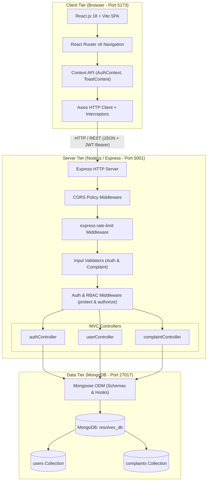
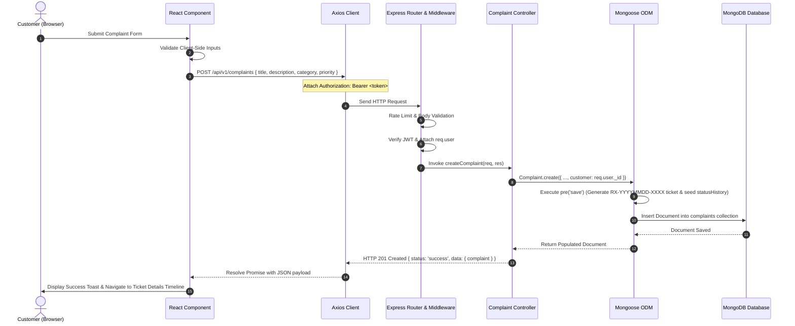
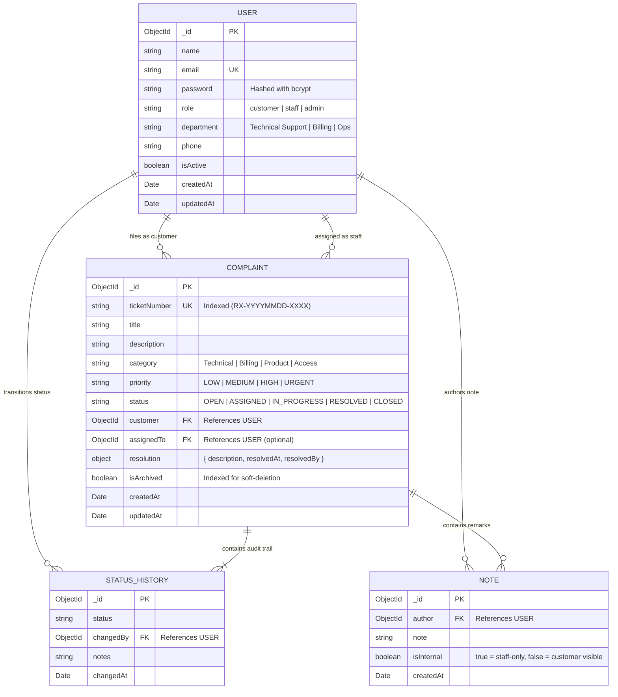

# ResolveX Architecture & Technical Design Document

**Course:** 19MAM57 — Full Stack Web Development Lab  
**Programme:** M.Sc Artificial Intelligence & Machine Learning (5-Year Integrated)  
**Institution:** Coimbatore Institute of Technology (CIT), Coimbatore  
**Assessment:** Continuous Assessment Test-II (CAT-II Practical)  

---

## 1. System Architecture Overview

ResolveX is designed as a modular 3-tier enterprise application separating Presentation (React.js SPA with Vite), Application Server (Node.js & Express RESTful API), and Persistent Database (MongoDB with Mongoose ODM).

---

## 2. End-to-End Data Flow Pipeline

The system enforces strict request/response data flow across all CRUD operations:

---

## 3. Database Entity-Relationship Diagram (ERD)

---

## 4. Security Architecture & Threat Mitigations

| Threat Vector | Mitigation Strategy Implemented in ResolveX |
| :--- | :--- |
| **Credential Stuffing & Brute Force** | `express-rate-limit` throttles IP requests to 15 authentication attempts per 15-minute window on `/api/v1/auth/login` and `/api/v1/auth/register`. |
| **Password Storage Breach** | Passwords are cryptographically hashed using `bcryptjs` with 10 salt rounds in a Mongoose pre-save middleware. Raw passwords are never stored or logged. Schema uses `select: false` to prevent accidental inclusion in query results. |
| **Privilege Escalation** | Public customer registration forces `role: 'customer'`. Admin and Staff accounts can only be provisioned by authenticated Administrators through `/api/v1/users`. |
| **Insecure Direct Object References (IDOR)** | When querying complaint details, the backend verifies ownership: if `req.user.role === 'customer'` and `complaint.customer !== req.user._id`, the server issues a `403 Forbidden` response. |
| **Information Leakage via Notes** | Internal staff notes marked with `isInternal: true` are filtered out before sending JSON responses to Customer clients. |
| **Cross-Origin Resource Sharing (CORS)** | Strict CORS policies allow requests only from verified origins (`http://localhost:5173`) with explicitly whitelisted HTTP verbs. |
| **DoS via Payload Flooding** | `express.json({ limit: '1mb' })` enforces strict payload bounds. |
| **Data Loss Prevention** | Soft deletion (`isArchived: true`) retains complaint history for auditing while removing tickets from active operational views. |
